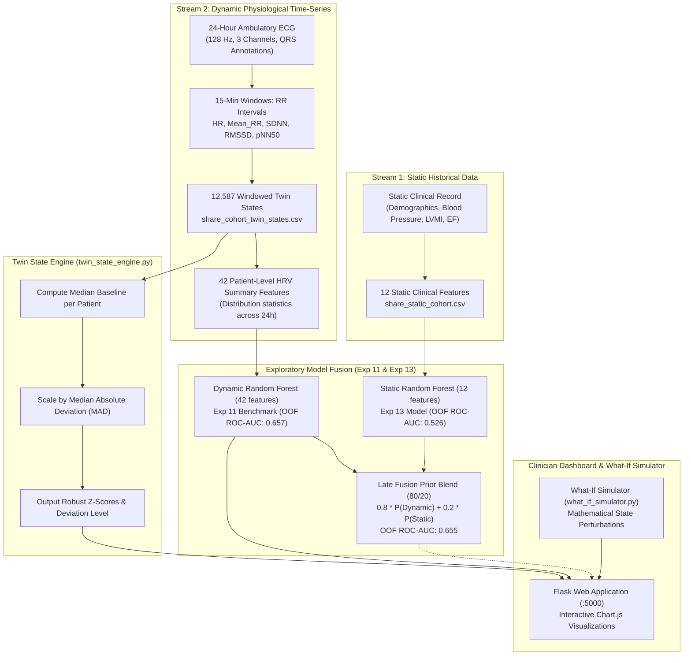

# SHARE Digital Twin

**Happiest Health Digital Twin Challenge 2026**\
**Research Prototype | Exploratory Cardiovascular Twin | Not for Clinical Use**

A physiological digital twin research prototype developed for the PhysioNet SHAREE database (139 hypertensive patients, 24-hour ambulatory ECG recordings). The system derives patient-specific autonomic baselines from ECG-derived Heart Rate Variability (HRV), monitors evolving multi-scale twin state deviations, explores dual-stream predictive modeling (combining static patient characteristics and dynamic HRV time-series features), and features a clinician-facing Flask dashboard with a counterfactual What-If simulation engine.

---

## Table of Contents

1. [Problem Statement](#1-problem-statement)
2. [Healthcare Use Case and Intended Beneficiaries](#2-healthcare-use-case-and-intended-beneficiaries)
3. [Proposed Solution and Digital Twin Framework](#3-proposed-solution-and-digital-twin-framework)
4. [System Architecture and Dual-Stream Data Flow](#4-system-architecture-and-dual-stream-data-flow)
5. [Technology Stack](#5-technology-stack)
6. [Dataset Provenance and Privacy Safeguards](#6-dataset-provenance-and-privacy-safeguards)
7. [Quick Start: Synthetic Demo (No Real Data Required)](#7-quick-start-synthetic-demo-no-real-data-required)
8. [Full Research Pipeline (Experiments 01-13)](#8-full-research-pipeline-experiments-01-13)
9. [Running the Dashboard with Real Data](#9-running-the-dashboard-with-real-data)
10. [Automated Tests and Verification](#10-automated-tests-and-verification)
11. [Model Evaluation and Limitations](#11-model-evaluation-and-limitations)
12. [Twin State Deviation vs. Clinical Risk](#12-twin-state-deviation-vs-clinical-risk)
13. [Counterfactual What-If Simulator](#13-counterfactual-what-if-simulator)
14. [Demonstration Workflow](#14-demonstration-workflow)
15. [Team and Institution Details](#15-team-and-institution-details)
16. [Submission Deliverables](#16-submission-deliverables)
17. [License and Data Governance](#17-license-and-data-governance)
18. [File Structure](#18-file-structure)

---

## 1. Problem Statement

Hypertension is a primary modifiable risk factor for severe cardiovascular outcomes, yet conventional clinical evaluations typically rely on periodic spot measurements (e.g., in-clinic blood pressure cuff readings). In contrast, autonomic nervous system regulation fluctuates continuously throughout the diurnal cycle.

The PhysioNet SHAREE database (*Smart Health for Assessing the Risk of Events via ECG Database*) provides 24-hour ambulatory ECG recordings for 139 European hypertensive patients who were followed longitudinally for 12 months for primary vascular events (myocardial infarction, ischemic stroke, syncopal events). In this cohort, only 17 patients experienced an adjudicated vascular event (12.2% event prevalence).

The challenge is to engineer an honest, scientifically grounded cardiovascular digital twin that:
- Captures each patient's individual physiological state from continuous ECG-derived HRV data.
- Tracks how autonomic regulation evolves over a 24-hour monitoring period without relying on arbitrary population-level thresholds.
- Quantifies state deviations against each patient's own median baseline using outlier-robust metrics.
- Integrates static clinical profiles with dynamic physiological time-series.
- Transparently discloses all statistical and cohort limitations without fabricating clinical or causal efficacy.

---

## 2. Healthcare Use Case and Intended Beneficiaries

### Clinical Research Workflow

```
[Patient Intake & Baseline] ──> [24-Hour Ambulatory Holter ECG] ──> [15-Minute Windowed HRV Extraction]
            │                                                                     │
            ▼                                                                     ▼
[Static Cardiovascular Profile]                                          [Patient Baseline Engine]
(Age, Sex, BMI, BP, LVMI, EF)                                            (Median HR, SDNN, RMSSD)
            │                                                                     │
            │                                                                     ▼
            │                                                        [Twin State Deviation Engine]
            │                                                        (MAD Robust Z-Scores per Window)
            │                                                                     │
            └───────────────> [Dual-Stream Contextualization] <───────────────────┘
                                        │
                                        ▼
                  [Interactive Clinician-Facing Twin Dashboard]
                  - Trajectory Timeline & Anomaly Highlighting
                  - Exploratory Risk Indication (With Honest Disclaimers)
                  - Controlled Counterfactual What-If Perturbation
```

1. **Intake & Stratification:** Clinicians establish the patient's static background (demographics, body mass index, baseline blood pressure, left ventricular mass index, and ejection fraction).
2. **Continuous Autonomic Monitoring:** High-resolution Holter ECG recordings (128 Hz, 3 leads) are segmented into sequential, non-overlapping 15-minute windows to extract validated time-domain HRV markers (`HR`, `Mean RR`, `SDNN`, `RMSSD`, `pNN50`).
3. **Personalized Baseline Calibration:** Rather than comparing against generic population cutoffs, the engine calculates the patient's own median baseline across their observed diurnal recording.
4. **Physiological Trajectory Tracking:** The twin monitors autonomic deviation over time, identifying periods of acute sympathetic dominance or vagal withdrawal via robust Median Absolute Deviation (MAD) scaling.
5. **Counterfactual Exploration:** Clinical researchers explore how hypothetical physiological shifts affect the twin's stability metrics using a bounded mathematical simulator.

### Intended Beneficiaries
- **Cardiology and Hypertension Researchers:** Investigating diurnal autonomic dynamics and seeking quantitative methods to profile individualized cardiovascular stability.
- **Digital Health Engineers:** Developing physiological digital twins that prioritize mathematical transparency and robust statistics over black-box predictions.
- **Clinical Data Scientists:** Evaluating multi-modal fusion of historical demographic covariates and high-frequency physiological time series on small, imbalanced medical cohorts.

### Mandatory Non-Validation Notice
> **Research Prototype Only — Not for Clinical Diagnostic or Treatment Use.**\
> This system is an investigative prototype engineered to demonstrate digital twin state modeling. It is **not** an FDA-cleared, CE-marked, or clinically validated medical device. It does not provide medical diagnoses, treatment recommendations, causal event predictions, or medication adjustments.

---

## 3. Proposed Solution and Digital Twin Framework

1. **Patient-Specific Autonomic Twin:** Standard medical thresholds frequently flag natural circadian variations as abnormal. This framework computes individualized baselines from each patient's median observed HRV values. State shifts are scaled using the Median Absolute Deviation (MAD), producing robust z-scores resistant to transient recording noise.
2. **Dual-Stream Information Architecture:** The framework systematically structures static historical data (demographics, clinical exams) and dynamic time-series features (15-minute windowed HRV statistics), investigating both early and late fusion schemes.
3. **Honest Exploratory Machine Learning:** Rather than obscuring model uncertainties, the predictive pipeline (5-fold stratified cross-validation) prominently surfaces the cohort imbalance (17 events across 139 patients) on every dashboard view and benchmark report.
4. **Non-Causal Counterfactual Simulation:** The What-If simulation engine applies mathematically bounded perturbations to observed states and calculates exact recomputed deviations. It explicitly refuses to fabricate clinical risk probabilities or claim therapeutic effects from single-point shifts.

---

## 4. System Architecture and Dual-Stream Data Flow

### Data Flow Diagram



### The Two Data Streams Explained

1. **Stream 1: Static Patient Characteristics (12 Features)**
   - Extracted from initial clinical examinations (`info.txt`): `sex`, `age`, `weight_kg`, `height_cm`, `BSA_m2`, `BMI`, `smoker`, `SBP_mmHg`, `DBP_mmHg`, `IMT_MAX_mm` (intima-media thickness), `LVMi_g_m2` (left ventricular mass index), and `EF_percent` (ejection fraction).
   - Captures baseline cardiovascular morphology and demographic risk factors.
2. **Stream 2: Dynamic ECG-Derived HRV Time-Series (42 Features)**
   - Continuous 24-hour Holter ECG recordings segmented into 15-minute non-overlapping epochs.
   - For each epoch, 5 primary time-domain HRV markers are computed: Heart Rate (`HR_bpm`), Mean RR Interval (`Mean_RR_ms`), Standard Deviation of NN intervals (`SDNN_ms`), Root Mean Square of Successive Differences (`RMSSD_ms`), and Proportion of NN intervals differing by >50ms (`pNN50_percent`).
   - Across the 24-hour recording, 8 summary statistics (`mean`, `std`, `min`, `max`, `median`, `first`, `last`, `change`) are derived for each marker, plus valid window count and recording duration (40 + 2 = 42 features).

### Dual-Stream Late Fusion (80/20 Prior Blend)
In Experiment 13, multiple fusion strategies were evaluated to synthesize the static and dynamic streams:
- **Early Fusion:** Concatenating 12 static and 42 dynamic features into a single 54-feature Random Forest produced an Out-Of-Fold (OOF) ROC-AUC of **0.647**.
- **Late Fusion (80/20 Prior Blend):** Combining model predictions via an ensemble weighting:
  $$\hat{P}_{\text{fusion}} = 0.80 \times \hat{P}_{\text{dynamic}} + 0.20 \times \hat{P}_{\text{static}}$$
  yielded an OOF ROC-AUC of **0.655** and an OOF Average Precision of **0.252**.
- **Scientific Non-Validation Notice:** The 80/20 weighting is an exploratory empirical prior chosen because the dynamic HRV stream demonstrated substantially higher predictive signal (OOF ROC-AUC 0.657) than the static clinical stream alone (OOF ROC-AUC 0.526). **This weighting is an engineering heuristic for research exploration and has not been clinically validated or externally proven.**

### Module Responsibilities

| Module | Purpose |
|---|---|
| `twin_state_engine.py` | Core engine computing median baselines, MAD scales, robust z-scores, and trajectory statistics. |
| `what_if_simulator.py` | Counterfactual simulation engine; applies bounded shifts and recalculates twin deviation. |
| `experiment_11_dashboard.py` | Flask server (`http://127.0.0.1:5000`) with safe zero-credential demo as default (`--demo`), and explicit `--real` research mode. |
| `generate_synthetic_demo.py` | Standalone generator producing reproducible synthetic cohort data for public review without real patient data. |
| `experiment_11_train_model.py` | Training script for the 42-feature dynamic Random Forest benchmark pipeline. |
| `experiment_13_model_fusion.py` | Training and cross-validation framework evaluating early and late dual-stream fusion models. |
| `templates/dashboard.html` | Responsive Chart.js web interface featuring trajectory graphs, deviation dials, and simulation sliders. |

---

## 5. Technology Stack

| Layer | Technologies & Dependencies | Purpose |
|---|---|---|
| **Core Runtime** | Python 3.12 / 3.13 | Primary computational runtime |
| **Data Processing** | `pandas` (>= 2.2), `numpy` (>= 1.26) | Vectorized windowing, summary aggregation, and matrix operations |
| **Biosignal Processing** | `wfdb` (>= 4.1), `scipy` (>= 1.13) | PhysioNet ECG record parsing, QRS detection handling, and signal filters |
| **Machine Learning** | `scikit-learn` (>= 1.4), `joblib` (>= 1.3) | Stratified K-Fold CV, pipelines, imputation, and Random Forest models |
| **Web Application** | `Flask` (>= 3.0), Jinja2 | Localhost REST API endpoints and web server |
| **Data Visualization** | `Chart.js` (4.4.1 via CDN), `matplotlib` (>= 3.8) | Interactive dashboard time-series and offline experimental trajectory plots |
| **Typography & Styling** | Inter (Google Fonts), Vanilla CSS | Clean, clinician-oriented aesthetic |

---

## 6. Dataset Provenance and Privacy Safeguards

### Dataset Identity, Attribution, and Citation
- **Database Name:** Smart Health for Assessing the Risk of Events via ECG Database (SHAREE database v1.0.0)
- **PhysioNet Record URL:** https://physionet.org/content/shareedb/1.0.0/
- **Digital Object Identifier (DOI):** [10.13026/C2RC7C](https://doi.org/10.13026/C2RC7C)
- **Primary Scientific Publication:**\
  P. Melillo, R. Izzo, A. Orrico, P. Scala, M. Attanasio, M. Mirra, N. De Luca, L. Pecchia, *"Automatic prediction of cardiovascular and cerebrovascular events using Heart Rate Variability analysis"*, *PLoS ONE* 10(3): e0118504 (March 20, 2015).\
  DOI: [10.1371/journal.pone.0118504](https://doi.org/10.1371/journal.pone.0118504).
- **PhysioNet Platform Citation:**\
  Pollard, T., Moody, B. E., Lehman, L., Gow, B., Fernandes, C., Xie, C., Johnson, A., Mark, R. G., & Heldt, T. (2026). *"PhysioNet as a global platform for biomedical research"*, *Nature Health*, 1(8), 792–795.\
  DOI: [10.1038/s44360-026-00096-z](https://doi.org/10.1038/s44360-026-00096-z).
- **Cohort Description:** Nominal 24-hour ambulatory Holter ECG recordings (128 Hz, 3 channels) for 139 European hypertensive patients recruited at the Centre of Hypertension of the University Hospital of Naples Federico II, Italy, followed for 12 months for vascular events (17 events: 11 myocardial infarctions, 3 strokes, 3 syncopal events).

### Dataset License: Open Data Commons Attribution License v1.0 (ODC-By v1.0)
The SHAREE database is an **Open Access** database licensed under the **Open Data Commons Attribution License v1.0 (ODC-By v1.0)**:
- **Official License Terms:** https://physionet.org/content/shareedb/view-license/1.0.0/ and https://opendatacommons.org/licenses/by/1.0/.
- **Attribution Obligation (ODC-By §4.2 & §4.3):** Any public conveyance of the database, derivative databases, or produced works must include an attribution notice acknowledging the database and linking to the ODC-By license text.
- **Distinction from Project Source Code License (ODC-By §2.3.a):** ODC-By §2.3.a explicitly excludes computer programs used in the making or operation of the database. The source code authored for this Digital Twin Challenge project is separate intellectual property and is governed by its own independent licensing.
- **Privacy and Data Protection Obligations (ODC-By §2.4):** While ODC-By grants open access to the database structure, Section 2.4 specifies that individual contents remain subject to privacy, data protection, and research ethics standards.

### Privacy Safeguards and Public Repository Exclusions
To uphold clinical privacy and data governance best practices:
1. **Raw ECG Waveforms Excluded:** The ~4.1 GB of raw Holter files (`share_data/*.dat`, `*.hea`, `*.qrs`) are excluded via [`.gitignore`](.gitignore). Researchers must obtain them directly from PhysioNet.
2. **Derived Patient Tables Excluded:** Intermediate tables containing individual clinical characteristics, ultrasound parameters, and outcome labels (`share_cohort_twin_states.csv`, `share_patient_level_dataset.csv`, `share_static_cohort.csv`, `patient_twin_dataset_*.csv`, `twin_states_*_validated.csv`) are excluded to prevent patient re-identification.
3. **Out-of-Fold Predictions Excluded:** Files containing true patient-level event labels (`*oof_predictions.csv`) are strictly excluded to protect clinical confidentiality and prevent target leakage.
4. **Trained `.joblib` Artifacts Quarantined:** Serialized model pipelines (`experiment_11_model/*.joblib`, `experiment_13_model/*.joblib`) are excluded from public release pending formal review. On a small cohort ($N=139$, 17 events), decision-tree threshold splits carry potential memorization or membership inference risks.
5. **Synthetic Demo Safeguard:** A dedicated synthetic cohort (`demo_data/`) is bundled to enable complete public evaluation without distributing real patient data.

---

## 7. Quick Start: Synthetic Demo (No Real Data Required)

Judges and evaluators can launch and test the complete Digital Twin dashboard immediately using the synthetic demonstration mode. **This mode requires zero real patient data and runs out-of-the-box from a clean clone.**

### Step 1 — Clone the Repository and Navigate to Folder

```bash
git clone https://github.com/lavanyakothapalli255-afk/share-digital-twin.git
cd share-digital-twin
```
*(If downloading as a ZIP archive, extract the files and open a terminal in the project directory).*

### Step 2 — Install Python Dependencies

```bash
pip install -r requirements.txt
```

### Step 3 — Launch the Dashboard in Demo Mode

```bash
python experiment_11_dashboard.py --demo
```
*(Launching without arguments `python experiment_11_dashboard.py` also defaults to synthetic demo mode. Zero real patient data is required).*

### Step 4 — Open the Dashboard

Open your web browser and navigate to:
```
http://127.0.0.1:5000
```
*(or `http://localhost:5000`)*

### Synthetic Demo Modes & Inference Behavior
The synthetic demo supports two operational behaviors depending on local model artifact availability:
1. **Behavior A — Trained Model Artifacts Available (Locally Trained):**\
   If compatible trained model pipelines (`experiment_11_model/exploratory_rf_pipeline.joblib` and optional `experiment_13_model/static_rf_pipeline.joblib`) are present in the local workspace (e.g., after running the training scripts locally), the dashboard performs real estimator inference on the synthetic patient features, outputting model-generated probability estimates.
2. **Behavior B — Model Artifacts Unavailable (Clean Clone / Public Release):**\
   If trained `.joblib` files are excluded or not present, the dashboard does not crash. Instead, it displays **explicitly labeled illustrative placeholder scores** (e.g., dynamic score `0.115` and static score `0.100` for `DEMO-001`).

> [!WARNING]
> **Illustrative Placeholder Disclaimer:**\
> When model artifacts are absent, placeholder scores are fixed UI constants. They are **not** machine learning predictions, statistical inferences, or validated clinical risk results. They exist solely for user interface evaluation, chart layout rendering, and interactive workflow verification.

### Synthetic Demo Safety Guarantees
- **Fictional Patient Cohort:** Loads 3 pre-generated synthetic patients: `DEMO-001`, `DEMO-002`, and `DEMO-003`.
- **Reproducible Generation:** Generated using [generate_synthetic_demo.py](generate_synthetic_demo.py) with fixed NumPy random seeds; zero overlap with real PhysioNet records.
- **Zero Real Clinical Risk:** All demo patients carry non-event labels (`vascular_event = 0`), ensuring no patient data is exposed or simulated.
- **Full Interactivity:** Provides complete access across the Overview, Twin State, Trajectory, Model Explanation, and What-If Simulator tabs.

---

## 8. Full Research Pipeline (Experiments 01-13)

> [!IMPORTANT]
> **Public-release scope:** The research results and experiment descriptions below document the work performed during development. The corresponding research scripts and real-data artifacts are not all included in this public-release staging set. The runnable entry point in this release is the synthetic demo described in Section 7. Do not run the research pipeline commands unless you have separately obtained and reviewed the required scripts, data, and model artifacts.

For researchers with access to the PhysioNet SHAREE database, the experimental workflow is documented below for reference. Not all research scripts and required artifacts are included in this public release; see the Public-release scope notice above.

> **Data Access:** While SHAREE is an Open Access database under the ODC-By v1.0 license, downloading the ~4.1 GB database files (`.dat`, `.hea`, `.qrs`) must be done directly from PhysioNet (https://physionet.org/content/shareedb/1.0.0/) or via `wget` / AWS S3 (`s3://physionet-open/shareedb/1.0.0/`). Raw data and derived tables are kept locally and are excluded from public version control.

| Experiment | Script | Inputs | Key Outputs | Description |
|---|---|---|---|---|
| **01** | `experiment_01.py` | PhysioNet SHAREE | `share_data/01911.*` | Download and inspect single-patient raw ECG and QRS annotations |
| **02** | `experiment_02.py` | `share_data/01911.*` | `twin_states_01911_15min.csv` | Extract 15-minute windowed HRV features across 24 hours |
| **03** | `experiment_03.py` | `twin_states_01911_15min.csv` | `twin_states_01911_validated.csv` | Compute median baseline and MAD-based robust z-scores |
| **04** | `experiment_04_prepare.py` | Single patient CSVs | `patient_twin_dataset_01911.csv` | Merge static clinical profile with dynamic windowed states |
| **05** | `experiment_05_full_cohort.py` | Full `share_data/` (139 pts) | `share_cohort_twin_states.csv`, `share_patient_level_dataset.csv` | Full-cohort extraction across all 139 patients (12,587 windows) |
| **06** | `experiment_06_baseline_models.py` | `share_patient_level_dataset.csv` | `experiment_06_model_results.csv` | Baseline classifier comparison (Logistic Regression, Random Forest, GBDT) |
| **07** | `experiment_07_feature_importance.py` | `share_patient_level_dataset.csv` | `experiment_07_*_importance.csv` | Permutation and Gini feature importance analysis |
| **08** | `experiment_08_twin_trajectory.py` | Full cohort states | `experiment_08_twin_trajectory_dataset.csv` | Extract trajectory stability and state-transition metrics |
| **09** | `experiment_09_ablation.py` | Combined datasets | `experiment_09_clean_ablation_results.csv` | Systematic feature subset ablation (Sets A through G) |
| **10** | `experiment_10_feature_audit.py` | Processed datasets | `experiment_10_feature_audit.csv` | Audit for data leakage, multicollinearity, and label leakage |
| **11** | `experiment_11_train_model.py` | `share_patient_level_dataset.csv` | `experiment_11_model/` | Train final 42-feature dynamic Random Forest benchmark pipeline |
| **12** | `what_if_simulator.py` | Live Twin State | Recomputed robust z-scores | Real-time counterfactual mathematical perturbation engine |
| **13** | `experiment_13_model_fusion.py` | `share_patient_level_dataset.csv` | `experiment_13_fusion_results.csv` | Dual-stream early vs. late fusion (80/20 blend evaluation) |

*Note: Experiments 01–05 require the raw PhysioNet SHAREE `.dat`, `.hea`, and `.qrs` files. Experiments 06–13 require only the aggregate CSVs generated by Experiment 05.*

---

## 9. Running the Dashboard with Real Data

> [!IMPORTANT]
> **Public-release scope:** The research results and experiment descriptions below document the work performed during development. The corresponding research scripts and real-data artifacts are not all included in this public-release staging set. The runnable entry point in this release is the synthetic demo described in Section 7. Do not run the research pipeline commands unless you have separately obtained and reviewed the required scripts, data, and model artifacts.

To run the dashboard on the real PhysioNet SHAREE cohort (for users who have downloaded the dataset and generated the required local CSVs):

### Prerequisites
1. Ensure `share_cohort_twin_states.csv` and `share_patient_level_dataset.csv` are in the project root directory.
2. Train the benchmark model pipeline (if `experiment_11_model/` is not already present):
   ```bash
   python experiment_11_train_model.py
   ```

### Launch Command
```bash
python experiment_11_dashboard.py --real
```
Open **http://127.0.0.1:5000** in your browser. (The server binds strictly to `127.0.0.1` and runs with `debug=False`).

---

## 10. Automated Tests and Verification

The repository includes a comprehensive test suite covering mathematical fidelity, simulator boundaries, and dual-stream API contracts:

### 1. What-If Simulator Unit Tests (10 Tests)
Verifies baseline immutability, zero-adjustment identity, HR-to-RR reciprocal consistency, and input boundary validation (±10% HR, ±20% HRV):
```bash
python test_what_if_simulator.py
```
*Expected: `Ran 10 tests - OK`*

### 2. Dual-Stream Integration Tests (Experiment 13)
Tests default dynamic mode behavior, the 80/20 late fusion calculation, missing value handling, and endpoint contracts:
```bash
python test_dual_stream_integration.py
```

### 3. Dashboard API Smoke Test
Verifies test-client responses for `/api/patient/01911` without launching a live server:
```bash
python test_api.py
```

### 4. Synthetic Demo Test
Validates synthetic data generation constraints, fixed seeds, and demo patient schema integrity:
```bash
python test_synthetic_demo.py
```

---

## 11. Model Evaluation and Limitations

### Cohort Imbalance & Sample Size Constraints
> **Severe Imbalance Warning:** The SHAREE cohort consists of 139 patients with only 17 confirmed 12-month vascular events (12.2% prevalence). All statistical results are exploratory and must not be interpreted as validated clinical risk models.

With 5-fold stratified cross-validation, each test fold contains only 3 to 4 positive cases. Consequently, fold-level ROC-AUC displays high variance.

### Ablation Study Results (Experiment 09, 5-Fold Stratified CV)

| Set | Feature Subset | Feature Count | OOF ROC-AUC | OOF Average Precision |
|---|---|---|---|---|
| **A** | Static Clinical Only | 12 | 0.527 | 0.137 |
| **B** | **Dynamic HRV Only (Exp 11 Benchmark)** | **42** | **0.657** | **0.259** |
| **C** | Trajectory Features Only | 22 | 0.558 | 0.165 |
| **D** | Static + Dynamic | 54 | 0.625 | 0.221 |
| **E** | Static + Trajectory | 34 | 0.520 | 0.134 |
| **F** | Dynamic + Trajectory | 64 | 0.605 | 0.218 |
| **G** | All Features Combined | 76 | 0.624 | 0.230 |

### Dual-Stream Model Fusion Results (Experiment 13, 5-Fold Stratified CV)

| Model Name | Fusion Strategy | Features | OOF ROC-AUC | OOF Average Precision | Mean Fold ROC-AUC |
|---|---|---|---|---|---|
| `Static_RF` | Static-Only RF | 12 | 0.526 | 0.137 | 0.561 ± 0.152 |
| `Static_LogReg` | Static-Only Logistic Regression | 12 | 0.496 | 0.133 | 0.480 ± 0.170 |
| `Dynamic_RF` | Dynamic-Only RF (Exp 11 Benchmark) | 42 | **0.657** | **0.259** | **0.699 ± 0.163** |
| `Early_Fusion_RF` | Concatenation (Early Fusion) | 54 | 0.647 | 0.232 | 0.687 ± 0.176 |
| `Late_Fusion_Equal`| 0.5 Dynamic + 0.5 Static | 54 | 0.611 | 0.201 | 0.629 ± 0.169 |
| `Late_Fusion_Prior80`| 0.8 Dynamic + 0.2 Static (Prior Blend) | 54 | **0.655** | **0.252** | **0.689 ± 0.165** |
| `Late_Fusion_Nested` | Nested CV Tuned Weight Blend | 54 | 0.533 | 0.149 | 0.554 ± 0.162 |

### Experiment 11 Benchmark Model Specifications

| Parameter | Setting |
|---|---|
| Algorithm | Random Forest Classifier (`RandomForestClassifier`) |
| Estimators | 500 trees |
| Class Balancing | `class_weight='balanced'` |
| Minimum Leaf Samples | 2 |
| Evaluation Protocol | 5-Fold Stratified Cross-Validation (`random_state=42`) |
| Out-of-Fold ROC-AUC | 0.657 |
| Out-of-Fold Average Precision | 0.259 (vs. baseline prevalence 0.122) |
| Mean Fold ROC-AUC | 0.699 ± 0.146 |

> [!NOTE]
> **Metric Reporting Note — Fold ROC-AUC Standard Deviation Conventions:**\
> The mean 5-fold cross-validation ROC-AUC for the 42-feature dynamic Random Forest benchmark is identical across both evaluations at **0.699**, with an aggregated out-of-fold (OOF) ROC-AUC of **0.657** (exact: **0.6572**). The difference in reported fold variance reflects distinct standard-deviation conventions:
> - **Experiment 11:** Reports the **population standard deviation** (`ddof=0`, divisor $N = 5$): **0.699 ± 0.146** (exact: `0.1459`).
> - **Experiment 13:** Reports the **sample standard deviation** with Bessel's correction (`ddof=1`, divisor $N - 1 = 4$): **0.699 ± 0.163** (exact: `0.1632`).
> Both conventions evaluate the exact same underlying 5-fold cross-validation results (fold ROC-AUCs: `0.8667`, `0.8400`, `0.6250`, `0.4688`, `0.6944`), where $\text{SD}_{\text{sample}} = \text{SD}_{\text{population}} \times \sqrt{5/4}$.

### Rigorous Scientific Limitations
1. **No External Validation:** The models have been evaluated exclusively via cross-validation within the single SHAREE cohort; performance on external populations is unverified.
2. **Association vs. Causation:** Feature importance identifies statistical correlation within the 24-hour recording, not physiological causation or modifiable targets.
3. **Short Recording Baseline:** Baselines are estimated from the same 24-hour recording rather than a separate pre-monitoring longitudinal baseline.
4. **Fold Variance:** Due to having only 17 event cases, test folds have wide performance bounds.
5. **No Frequency Domain / Wearable Streaming:** The analysis is restricted to time-domain HRV from 128 Hz ECG. It does not process frequency-domain features (LF/HF) or live PPG wearable streams.

---

## 12. Twin State Deviation vs. Clinical Risk

**Twin State Deviation is an engineering stability metric, not a clinical diagnostic score.**

For each 15-minute epoch, the twin state deviation is formulated as:
$$\text{Robust Z-Score}_i = \frac{x_i - \text{Median}(X_i)}{1.4826 \times \text{MAD}(X_i)}$$
$$\text{Twin State Deviation} = \frac{1}{5} \sum_{i=1}^{5} |\text{Robust Z-Score}_i|$$
where $X_i$ represents the series of window values for metric $i \in \{\text{HR}, \text{Mean RR}, \text{SDNN}, \text{RMSSD}, \text{pNN50}\}$, and $1.4826$ scales the MAD to estimate the standard deviation under normal distributions.

### Engineering State Classifications

| State Classification | Metric Range | Technical Meaning |
|---|---|---|
| **Near Baseline** | $\text{Deviation} < 1.0$ | Physiological values remain within the patient's typical median range |
| **Moderate Deviation** | $1.0 \le \text{Deviation} < 2.0$ | Values exhibit mild dispersion from typical diurnal behavior |
| **High Deviation** | $\text{Deviation} \ge 2.0$ | Substantial autonomic divergence relative to the patient's personal baseline |

These categories are visual engineering thresholds designed to highlight anomalous recording windows. They **do not** correspond to graded clinical risk categories or urgent care alerts.

---

## 13. Counterfactual What-If Simulator

The What-If Simulator (Experiment 12) demonstrates how the digital twin responds dynamically to user-defined perturbations of observed physiology.

### Functional Behavior
- Accepts bounded percentage adjustments: Heart Rate ($\pm 10\%$), SDNN ($\pm 20\%$), RMSSD ($\pm 20\%$), and pNN50 ($\pm 20\%$).
- If Heart Rate is altered, the Mean RR interval is recomputed reciprocally as $\text{Mean RR} = \frac{60000}{\text{HR}}$.
- Recomputes robust z-scores and overall Twin State Deviation in real time against the patient's immutable baseline.

### Transparent Scientific Constraints
- **No Treatment Effect Estimation:** The simulator does not claim that lifestyle or pharmacological interventions will produce these shifts.
- **Suppressed Risk Prediction:** The 42-feature Random Forest model requires full 24-hour distributional statistics. A single point-in-time perturbation cannot reconstruct 42 features authentically. The dashboard explicitly suppresses predictive recomputation with the disclaimer:\
  *"Exploratory model response not computed for this simulation because available data do not support reliable reconstruction of all 42 patient-level features."*
- **Strict Server-Side Validation:** Out-of-bounds parameters return sanitised HTTP 400 errors without exposing server stack traces.

---

## 14. Demonstration Workflow

When running the dashboard (`http://127.0.0.1:5000`):

1. **Overview Tab:** Select patient (e.g., `01911` in real mode, or `DEMO-001` in demo mode). Inspect recording coverage (hours, valid 15-minute epochs) and static clinical profile (age, sex, BMI, baseline blood pressure).
2. **Twin State Tab:** Examine the current 15-minute window against the patient's personal median baseline. Review absolute differences, MAD robust z-scores, and the cohort deviation distribution.
3. **Trajectory Tab:** Navigate the 24-hour time-series visualizations for Heart Rate, SDNN, RMSSD, pNN50, and composite deviation.
4. **Model Explanation Tab:** View the top-15 feature importances and inspect the prominent scientific disclaimer disclosing the 17-event cohort limitation.
5. **What-If Simulation Tab:** Adjust physiological sliders (e.g., decrease HR by 5%, increase RMSSD by 10%). Observe the immediate recomputation of twin state deviation and observe the deliberate suppression of simulated clinical outcomes.

---

## 15. Team and Institution Details

> *Fields below are designated for official challenge submission records.*

- **Team Name:** `lavanyakothapalli255`
- **Institution:** Bonam Venkata Chalamayya Institute of Technology and Science (BVCITS), Batlapalem, Amalapuram
- **Team Size:** 4 members
- **Faculty Advisor / Mentor:** None
- **Team Members:**
  1. Vijaya Durga Lavanya Kothapalli
  2. Leela Lakshmi Prasanna Karatam
  3. Durga Swetha Sri Kamana
  4. Suji Muramalla

| Team Member | Role | Contributions |
|---|---|---|
| **Vijaya Durga Lavanya Kothapalli** | Project Integration & Dashboard | Integrated project components, developed the dashboard, prepared the synthetic demo, and maintained project documentation. |
| **Leela Lakshmi Prasanna Karatam** | ECG Processing & Digital Twin State | Worked on ECG/HRV processing, digital twin state generation, and baseline deviation analysis. |
| **Durga Swetha Sri Kamana** | Machine Learning & Evaluation | Worked on machine learning models, evaluation, and feature importance analysis. |
| **Suji Muramalla** | Testing & Presentation | Worked on dashboard testing, visualizations, architecture preparation, and presentation development. |


---

## 16. Submission Deliverables

| Deliverable | Requirement | Submission Status / Link |
|---|---|---|
| **Demonstration Video** | Comprehensive video walkthrough (20 minutes 33 seconds). | [Watch Demo](https://youtu.be/SHqkDYNv4Tk) |
| **System Architecture Document** | Standalone architecture diagram and technical design document in PDF or PPT format. | [architecture/architecture_diagram.pdf](architecture/architecture_diagram.pdf) |
| **Final Presentation Slide Deck** | Final presentation covering the challenge, methodology, results, and limitations. | [View Presentation](./SHARE%20Digital%20Twin.pptx) |
| **Public GitHub Repository** | Public open-source code repository with clean-clone reproducibility and documentation. | `[https://github.com/lavanyakothapalli255-afk/share-digital-twin]` |

---

## 17. License and Data Governance

### Source Code License (MIT License)
The original project source code developed for this Digital Twin Challenge 2026 entry is licensed under the **MIT License**. See the root-level [`LICENSE`](LICENSE) file for the full legal text:
- **Copyright:** `Copyright (c) 2026 Digital Twin Challenge Project Contributors`
- **Scope:** The MIT License applies strictly to our original source code files (including `twin_state_engine.py`, `what_if_simulator.py`, `experiment_11_dashboard.py`, `generate_synthetic_demo.py`, experiment scripts, test suites, and HTML/CSS templates).

### Scope Limitations & Exclusions
The MIT License does **not** automatically cover:
1. **The PhysioNet SHAREE Dataset:** The underlying clinical database is governed independently by the **Open Data Commons Attribution License v1.0 (ODC-By v1.0)** ([DOI: 10.13026/C2RC7C](https://doi.org/10.13026/C2RC7C)).
2. **Clinical Patient Data & Derived Tables:** Raw Holter recordings (`share_data/`) and intermediate patient-level derived tables (`share_cohort_twin_states.csv`, `share_patient_level_dataset.csv`, `patient_twin_dataset_*.csv`, etc.) remain excluded from public redistribution to protect patient privacy and clinical confidentiality.
3. **Trained Model Artifacts:** Serialized `.joblib` model files (`experiment_11_model/*.joblib`, `experiment_13_model/*.joblib`) remain quarantined in [`.gitignore`](.gitignore) pending formal privacy and memorization review.
4. **Third-Party Dependencies:** Third-party libraries and frameworks (such as `scikit-learn`, `wfdb`, `Flask`, `pandas`, `numpy`, `scipy`, and `Chart.js`) retain their respective upstream open-source licenses.

### Dataset License & Attribution
**Status:** The SHAREE database (*Smart Health for Assessing the Risk of Events via ECG Database* v1.0.0) is made available under the **Open Data Commons Attribution License v1.0 (ODC-By v1.0)**.
- **Attribution Notice:** Contains information from the *Smart Health for Assessing the Risk of Events via ECG Database* (SHAREE), available at https://physionet.org/content/shareedb/1.0.0/ under the [Open Data Commons Attribution License v1.0](https://opendatacommons.org/licenses/by/1.0/).
- **Distinction from Software License:** Per ODC-By §2.3.a, this repository's software code is independent intellectual property and is licensed separately under the MIT License.
- **Privacy Protections:** Raw physiological recordings, patient-level derived CSVs, and out-of-fold prediction files are excluded from public Git repositories via [`.gitignore`](.gitignore).

---

## 18. File Structure


The following files are included in the current public-release staging set. Local research scripts, patient-level data, and quarantined model artifacts are not included in this file list.

```text
share-digital-twin/
|-- .gitignore
|-- LICENSE
|-- README.md
|-- requirements.txt
|-- experiment_11_dashboard.py
|-- generate_synthetic_demo.py
|-- twin_state_engine.py
|-- what_if_simulator.py
|-- architecture/
|   |-- architecture_diagram.pdf
|   |-- architecture_diagram.png
|   `-- architecture_diagram.svg
|-- demo_data/
|   |-- demo_feature_importance.json
|   |-- synthetic_cohort_twin_states.csv
|   `-- synthetic_patient_level_dataset.csv
|-- templates/
|   `-- dashboard.html
|-- test_synthetic_demo.py
`-- test_what_if_simulator.py
```
